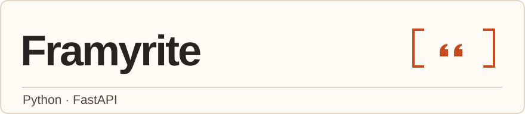
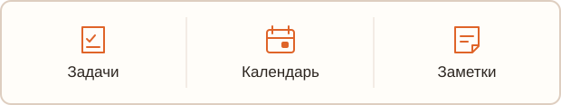
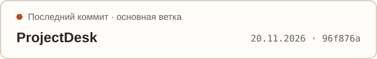

Разрабатываю REST API на Python, работаю с SQL и собираю приложения для локального запуска и деплоя.

## Избранные проекты

### [FinDocs](https://github.com/Framyrite/FinDocs)

Веб-приложение для вопросов по TXT-документам. FastAPI ищет подходящие фрагменты, а локальная модель через Ollama формирует ответ с цитатами из документов.

### [ProjectDesk](https://github.com/Framyrite/ProjectDesk)

Настольный органайзер для задач, дедлайнов и заметок. Хранит данные локально в SQLite и работает без аккаунта.

## Стек

| Направление | Как использую |
| --- | --- |
| **Бэкенд** | **Python** для приложений, библиотек и скриптов. **FastAPI** для REST API с OpenAPI |
| **Данные** | **PostgreSQL** для схем и связей, **SQL** для запросов с JOIN и агрегациями, **SQLite** для локального хранения |
| **Окружение и деплой** | **Docker** для сборки образов, **Docker Compose** для совместного запуска сервисов. Разворачиваю приложения на VPS и облачных платформах |
| **Качество кода** | **pytest** для тестов функций и API, линтеры и проверка типов, **GitHub Actions** для автоматических проверок и сборок |
| **Инструменты** | **ChatGPT и Codex** для планирования изменений, работы с кодом, тестами и отладкой. **Ollama** для подключения локальных моделей к приложениям |

## Активность проектов

