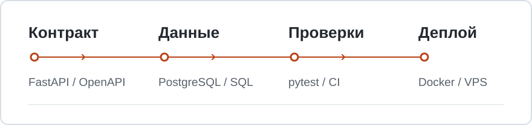
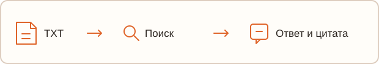
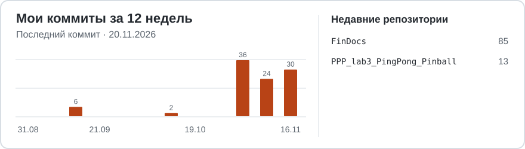

# Framyrite

**Python-разработчик. Пишу бэкенд и изучаю ИИ.**

Мне нравится разбираться, как работают ИИ-инструменты, и пробовать их в разных задачах. С ChatGPT и Codex разбираю идеи, работаю с кодом, пишу тесты и ищу причины ошибок. С Ollama пробую подключать локальные модели к приложениям. Бэкенд — моя основная практика, а за его пределами люблю осваивать новое в IT.

## Как я работаю

Описываю REST API на FastAPI и OpenAPI. В PostgreSQL проектирую таблицы и связи, пишу запросы с JOIN и агрегациями. Для локального хранения использую SQLite.

Проверяю функции и API с pytest, использую линтеры и проверку типов, запускаю проверки в GitHub Actions. Собираю образы Docker и окружения в Compose, разворачиваю приложения на VPS или в облаке.

<picture>
  <source media="(prefers-color-scheme: dark)" srcset="./assets/backend-map-dark.svg">
  <source media="(prefers-color-scheme: light)" srcset="./assets/backend-map.svg">
  
</picture>

## Проект · FinDocs

Веб-приложение для вопросов по TXT-документам. Находит подходящие фрагменты и показывает ответ с цитатами, которые можно сверить с источником.

**Мой вклад** — серверная библиотека документов. Реализовал HTTP API для загрузки, поиска и удаления TXT, локальное хранение и фоновую обработку. Добавил восстановление прерванной обработки при перезапуске. [Pull request](https://github.com/Framyrite/FinDocs/pull/7)

<picture>
  <source media="(prefers-color-scheme: dark)" srcset="./assets/findocs-dark.svg">
  <source media="(prefers-color-scheme: light)" srcset="./assets/findocs.svg">
  
</picture>

[Репозиторий](https://github.com/Framyrite/FinDocs) · [Демонстрационные вопросы](https://github.com/Framyrite/FinDocs/blob/main/qa/demo/demo_questions.md)

## Активность на GitHub

<picture>
  <source media="(prefers-color-scheme: dark)" srcset="./assets/activity-dark.svg">
  <source media="(prefers-color-scheme: light)" srcset="./assets/activity.svg">
  
</picture>

График показывает мои коммиты в основных ветках до пяти публичных репозиториев с моими самыми свежими коммитами. [Коммиты на GitHub](https://github.com/search?q=author%3AFramyrite&type=commits)
