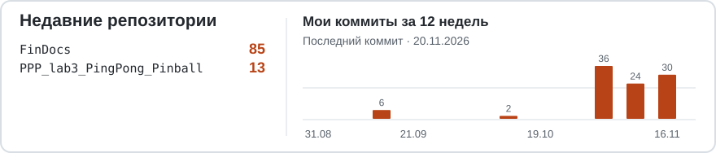

# Framyrite

**Разрабатываю бэкенд на Python и руковожу FinDocs – от требований и координации команды до реализации серверной части.**

Меня интересует, как языковые модели помогают в разработке и как их можно встраивать в приложения. С ChatGPT и Codex прорабатываю решения и отлаживаю код, а с Ollama экспериментирую с локальными моделями.

## Как я работаю

Описываю REST API на FastAPI и OpenAPI. В PostgreSQL проектирую таблицы и связи, пишу запросы с JOIN и агрегациями. Для локального хранения использую SQLite.

Проверяю функции и API с pytest, использую линтеры и проверку типов, запускаю проверки в GitHub Actions. Собираю образы Docker и окружения в Compose, разворачиваю приложения на VPS или в облаке.

<picture>
  <source media="(prefers-color-scheme: dark)" srcset="./assets/backend-map-dark.svg">
  <source media="(prefers-color-scheme: light)" srcset="./assets/backend-map.svg">
  
</picture>

## Проект · FinDocs

FinDocs – веб-приложение для работы с документами. По вопросу пользователя оно находит подходящие фрагменты, формирует ответ и приводит цитаты из источников, по которым можно проверить выводы.

**Моя роль.** Руковожу проектом как проектный менеджер и бизнес-аналитик. Прорабатываю требования и координирую работу команды. Также разрабатывал бэкенд на FastAPI и реализовал API для работы с документами, локальное хранение и фоновую обработку.

<picture>
  <source media="(prefers-color-scheme: dark)" srcset="./assets/findocs-dark.svg">
  <source media="(prefers-color-scheme: light)" srcset="./assets/findocs.svg">
  
</picture>

[Репозиторий](https://github.com/Framyrite/FinDocs) · [Демонстрационные вопросы](https://github.com/Framyrite/FinDocs/blob/main/qa/demo/demo_questions.md)

## Активность на GitHub

<picture>
  <source media="(prefers-color-scheme: dark)" srcset="./assets/profile-activity-dark.svg">
  <source media="(prefers-color-scheme: light)" srcset="./assets/profile-activity.svg">
  
</picture>

График показывает мои коммиты в основных ветках до пяти публичных репозиториев с моими самыми свежими коммитами. [Коммиты на GitHub](https://github.com/search?q=author%3AFramyrite&type=commits)
